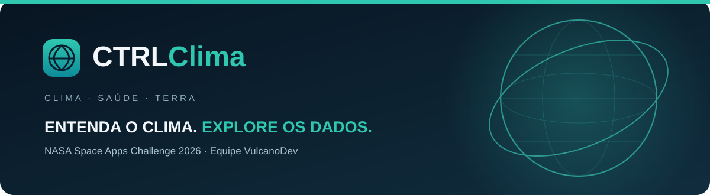
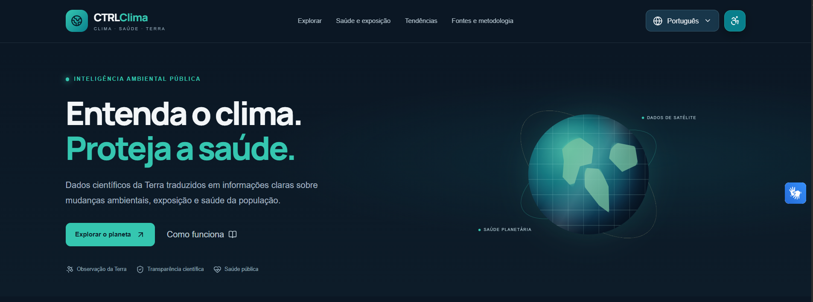
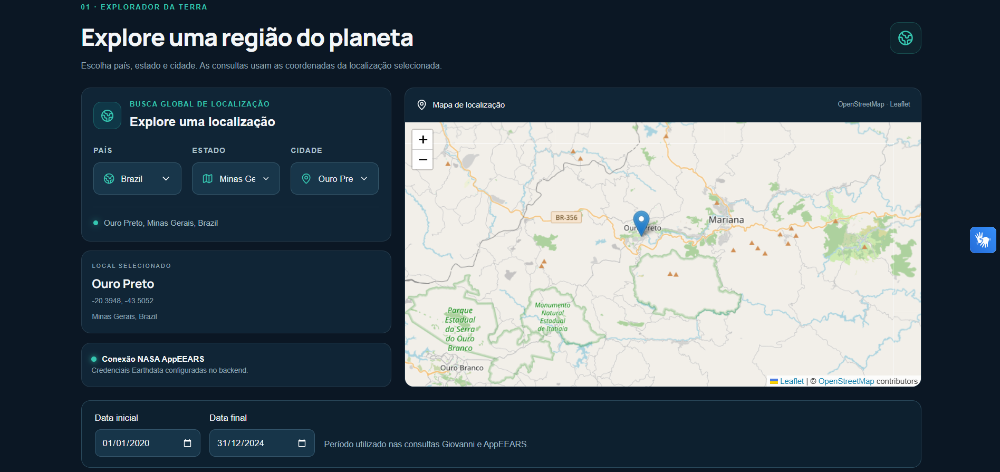
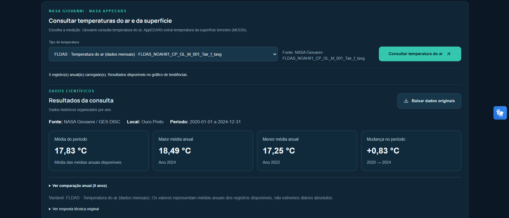
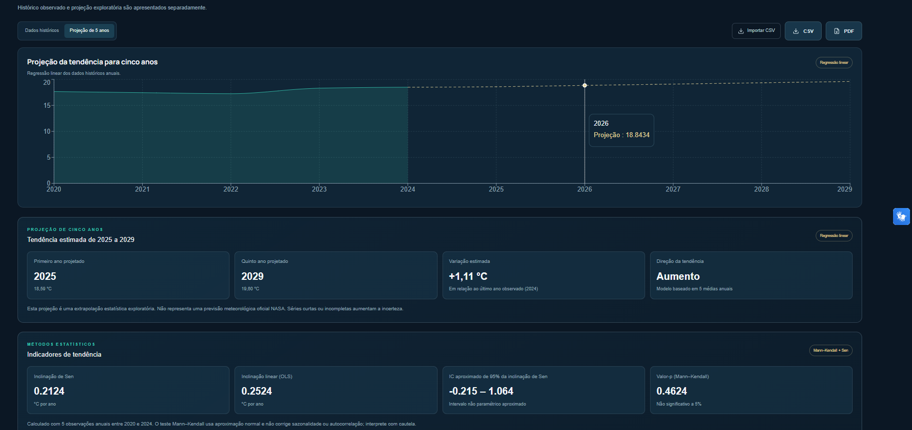

<div align="center">



**Interface web · React + TypeScript + Vite**

[](https://crtlclima-f.onrender.com)
[](https://crtlclima-b.onrender.com/api/docs)


[**Acessar aplicação**](https://crtlclima-f.onrender.com) · [**Documentação da API**](https://crtlclima-b.onrender.com/api/docs) · [**Backend no GitHub**](https://github.com/leticiaprofissionaladm-debug/CrtlClima-B)

</div>

---

Interface web do **CTRLClima**, projeto de exploração e interpretação de dados ambientais. A plataforma permite selecionar regiões, visualizar informações em mapas e gráficos, consultar séries ambientais e investigar tendências com atenção às fontes e limitações científicas.

> **Importante:** o CTRLClima não substitui serviços oficiais de previsão meteorológica, nem oferece diagnósticos médicos. Projeções exploratórias não são previsões oficiais da NASA.

## Acesse a aplicação

- **Frontend publicado:** https://crtlclima-f.onrender.com
- **Documentação da API:** https://crtlclima-b.onrender.com/api/docs
- **Repositório do backend:** https://github.com/leticiaprofissionaladm-debug/CrtlClima-B

## Visão da plataforma

<div align="center">


*Página inicial — visual escuro com destaques em verde-turquesa.*


*Seleção de região e mapa interativo.*

<details>
<summary><strong>Ver resultados científicos e projeções (capturas de tela)</strong></summary>





</details>

</div>

## Recursos

- Seleção de país, estado e cidade, com visualização geográfica.
- Mapas interativos com Leaflet e React Leaflet.
- Gráficos e indicadores com Recharts.
- Interface multilíngue com português, inglês e espanhol (i18next).
- Consultas ambientais por meio do backend, com suporte a fluxos NASA Giovanni e AppEEARS.
- Exibição contextualizada de dados, fontes e limitações.
- Análise exploratória de séries temporais e tendências, conforme os dados disponíveis.
- Recursos de acessibilidade da interface.

A disponibilidade de gráficos e indicadores depende de dados reais retornados pelas integrações ou de arquivos CSV importados pelo usuário. Não presuma que um gráfico sempre será preenchido.

## Tecnologias

- React 19 e TypeScript
- Vite 8
- React Router
- Axios
- Leaflet / React Leaflet
- Recharts
- i18next / react-i18next
- Tailwind CSS
- Oxlint

## Pré-requisitos

- Node.js **22.22.3 ou superior** (conforme `package.json`)
- npm
- Backend CTRLClima em execução ou publicado

## Comece aqui — do zero no Windows

1. Instale o [Git](https://git-scm.com/downloads/win) e o [Node.js](https://nodejs.org/) compatível com o requisito abaixo; reinicie o terminal.
2. Abra o **CMD** ou o terminal do **VS Code** e baixe este repositório:

   ```cmd
   git clone https://github.com/leticiaprofissionaladm-debug/CrtlClima-F.git
   cd CrtlClima-F
   npm install
   ```

3. Crie o arquivo `.env` na raiz do projeto com `VITE_API_URL=https://crtlclima-b.onrender.com/api` para usar o backend já publicado.
4. Execute `npm run dev` e abra o endereço exibido pelo Vite, normalmente `http://localhost:5173`.
5. Se preferir executar o backend local, siga as instruções do [README do backend](https://github.com/leticiaprofissionaladm-debug/CrtlClima-B) e use `VITE_API_URL=http://localhost:3000/api`.

> **Para quem só quer utilizar o sistema:** não é necessário instalar nada; abra [CTRLClima online](https://crtlclima-f.onrender.com).

## Instalação e execução local (referência rápida)

```bash
git clone https://github.com/leticiaprofissionaladm-debug/CrtlClima-F.git
cd CrtlClima-F
npm install
```

Crie um arquivo `.env` na raiz do frontend com:

```env
VITE_API_URL=http://localhost:3000/api
```

Caso prefira acessar a API publicada no Render:

```env
VITE_API_URL=https://crtlclima-b.onrender.com/api
```

Inicie o servidor de desenvolvimento:

```bash
npm run dev
```

Abra a URL mostrada pelo Vite no terminal (normalmente `http://localhost:5173`).

## Scripts disponíveis

| Comando | Descrição |
| --- | --- |
| `npm run dev` | Inicia o ambiente de desenvolvimento com Vite |
| `npm run build` | Verifica TypeScript e gera a versão de produção |
| `npm run preview` | Pré-visualiza localmente o build de produção |
| `npm run lint` | Executa o Oxlint |

## Publicação no Render

Crie um **Static Site** conectado ao repositório `CrtlClima-F`:

| Configuração | Valor |
| --- | --- |
| Branch | `main` |
| Root Directory | vazio (raiz do repositório) |
| Build Command | `npm install && npm run build` |
| Publish Directory | `dist` |
| Environment Variable | `VITE_API_URL=https://crtlclima-b.onrender.com/api` |

Após definir ou alterar `VITE_API_URL`, **faça um novo build/deploy**, pois as variáveis `VITE_` são incorporadas ao frontend durante a compilação.

Para páginas controladas pelo React Router, configure um rewrite de `/*` para `/index.html` no Render.

## Problemas frequentes

**“Não foi possível carregar os países”**

1. Abra `https://crtlclima-b.onrender.com/api/locations/countries` e confira se o backend responde.
2. Confira `VITE_API_URL` no serviço frontend do Render.
3. Refaça o build do frontend após alterar a variável.
4. No navegador, abra `F12` → **Network** e confira a requisição `countries`.
5. Verifique se o backend permite a origem `https://crtlclima-f.onrender.com` no CORS.

**Não exponha tokens, senhas ou dados privados em variáveis `VITE_`**, pois elas ficam disponíveis no código enviado ao navegador.

## Equipe

**VulcanoDev**

- Raphael Senna Masseron
- Leticia Alves Lima
- Simone Cristina Nunes

## Transparência científica

Dados de temperatura do ar e temperatura da superfície representam medições diferentes. Análises de tendências dependem de período, qualidade e quantidade de observações; uma regressão linear isolada não prova mudanças climáticas nem prevê eventos como El Niño.

Projeto independente desenvolvido para o **NASA Space Apps Challenge 2026**. O uso de dados e serviços públicos da NASA não implica endosso ou validação oficial da aplicação pela NASA.
